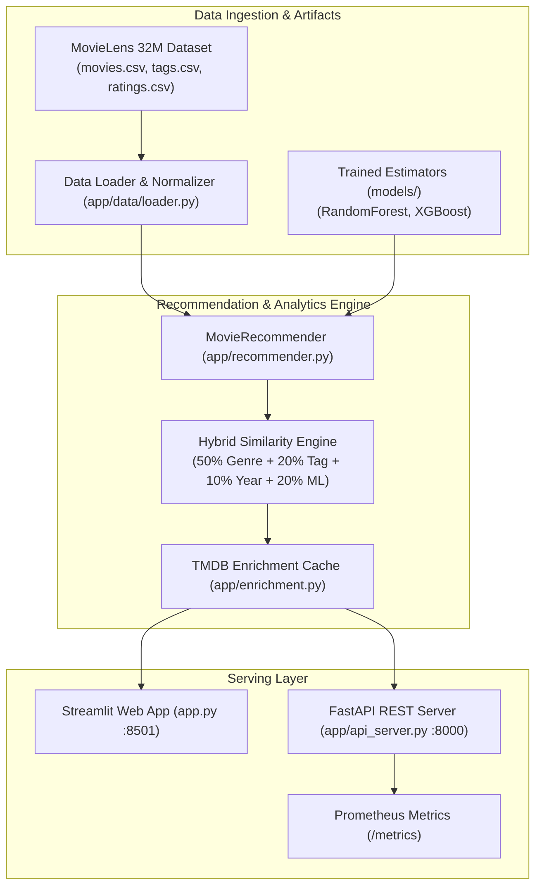

# Next-Gen-Reco (MovieLens AI)

[](https://github.com/themanoj-025/Next-Gen-Reco/actions)
[](./LICENSE)
[](https://www.python.org/)
[](https://fastapi.tiangolo.com/)
[](https://streamlit.io/)
[](tests/)

High-performance movie recommendation and rating prediction platform powered
by the MovieLens 32M benchmark dataset (87,000+ titles, 32 million ratings,
and 2 million user-applied tags). Combines a hybrid content-filtering similarity
engine, gradient-boosted rating predictors, an interactive Streamlit UI, and
a production FastAPI microservice.

---

## Quick Facts

| Dimension | Details |
| --- | --- |
| **Domain** | Entertainment Intelligence, Recommender Systems & Rating Prediction |
| **Dataset Scale** | MovieLens 32M (87K+ movies, 32M ratings, 2M tags) |
| **Hybrid Similarity** | Multi-factor weighted blend: 50% Genre + 20% Tags + 10% Year Proximity + 20% Predicted Rating |
| **Predictive ML** | Random Forest and XGBoost regression models estimating global viewer ratings |
| **Interfaces** | Interactive Streamlit web portal + Production FastAPI async REST microservice |
| **Observability** | Structured logging, Prometheus metrics (`/metrics`), circuit breakers |
| **Test Coverage** | 388 collected tests across 22 unit, golden, and integration test suites |
| **License** | [MIT License](./LICENSE) |

---

## Table of Contents

- [What It Does](#what-it-does)
- [Hybrid Similarity Formula](#hybrid-similarity-formula)
- [Screenshots](#screenshots)
- [Key Features](#key-features)
- [Architecture](#architecture)
- [Tech Stack](#tech-stack)
- [Prerequisites](#prerequisites)
- [Quick Start](#quick-start)
- [Configuration](#configuration)
- [Project Structure](#project-structure)
- [API Reference](#api-reference)
- [Testing](#testing)
- [Limitations](#limitations)
- [Contributing](#contributing)
- [Security](#security)
- [License](#license)

---

## What It Does

Recommending films from massive catalogs (87,000+ titles) presents significant
cold-start and diversity challenges. Naive collaborative filters fail when new
titles lack interaction volume, while pure genre matchers suggest redundant or
low-quality movies.

**Next-Gen-Reco** overcomes these hurdles:
1. **Hybrid Similarity Matching:** Combines cosine genre vectors, Jaccard tag
   overlap, release decade proximity, and quality-adjusted predicted ratings.
2. **Supervised Rating Forecasting:** Uses scikit-learn and XGBoost estimators
   trained on viewer demographics and metadata to forecast user reception.
3. **Smart Search & Fuzzy Match:** Employs tokenized fuzzy search with edit distance
   tolerance to locate titles instantly across 87K records.
4. **Enriched Context:** Integrates with The Movie Database (TMDB) API to fetch
   high-resolution posters, cast lists, crew bios, and revenue metrics on demand.
5. **Dual Serving Interfaces:** Delivers an engaging Streamlit discovery dashboard
   for end-users alongside a high-throughput, rate-limited FastAPI backend.

---

## Hybrid Similarity Formula

The recommendation engine scores catalog candidates against a selected seed
movie using a calibrated multi-factor objective function:

| Component | Weight | Metric / Technique | Purpose |
| --- | --- | --- | --- |
| **Genre Vector** | **50%** | Cosine similarity over 20 standard genre dimensions | Guarantees thematic and stylistic continuity |
| **Tag Overlap** | **20%** | Jaccard coefficient on top 50 TF-IDF user tags | Captures subtle narrative tropes (e.g. `dystopia`, `mind-bending`) |
| **Year Proximity** | **10%** | Exponential decay based on release year delta | Balances contemporary titles vs classical cinema |
| **Rating Alignment** | **20%** | Normalized ML predicted rating score | Elevates critically acclaimed movies and suppresses low-rated titles |

---

## Screenshots

<!-- TODO[L2-01]: Add movie search and recommendation view screenshots from running Streamlit instance -->
> *Interactive movie explorer, multi-attribute radar plots, and top-N similar recommendation cards.*

---

## Key Features

- **87,000+ Movie Catalog:** Instantaneous in-memory filtering and search
  optimized with precomputed title token tables and sparse genre matrices.
- **Explainable Recommendation Cards:** Every suggested movie displays its
  similarity percentage along with feature contribution breakdowns (Genre %, Tag %, Rating %).
- **Diversity Re-Ranking:** Optional Maximal Marginal Relevance (MMR) toggle
  ensures recommendations avoid recommending 10 consecutive sequels from a single franchise.
- **Robust Poster & Metadata Caching:** Multi-tier cache stores TMDB metadata
  locally in JSON and disk caches to avoid redundant external network calls.
- **Production REST Microservice:** Async FastAPI service with OpenAPI docs (`/docs`),
  Prometheus latency histograms, SlowAPI rate limiting, and Bearer token security.

---

## Architecture



### Component Breakdown

- **`app/recommender.py`**: The core algorithmic orchestrator combining genre
  vector dot products, tag set lookups, and ML rating predictions into ranked lists.
- **`app/api_server.py`**: Enterprise HTTP gateway exposing `/api/v1/search`,
  `/api/v1/recommend/{id}`, and `/api/v1/movies/{id}`.
- **`app/enrichment.py`**: Resilient client handling TMDB posters, cast metadata,
  and local disk caching with exponential backoff.

---

## Tech Stack

| Layer | Component | Version | Purpose |
| --- | --- | --- | --- |
| **Runtime** | Python | `>=3.10` | High-efficiency typed runtime |
| **Interactive UI** | Streamlit | `>=1.40.0` | Exploratory recommendation dashboard |
| **API Framework** | FastAPI & Uvicorn | `>=0.143.0` | Asynchronous REST service |
| **Machine Learning** | scikit-learn & XGBoost | Latest | Viewer rating prediction models |
| **Data Processing** | Pandas & NumPy | Latest | Vector operations and dataframe transformations |
| **Visualizations** | Plotly | Latest | Similarity radar charts and rating distributions |
| **Rate Limiter** | SlowAPI | Latest | IP-based request rate limiting |
| **Metrics** | Prometheus Client | Latest | Latency histograms and throughput metrics |

---

## Prerequisites

- **Python 3.10+** (Python 3.11 recommended)
- **uv** (recommended) or standard `pip`
- Optional: **TMDB API Key** (for downloading real movie posters and metadata)

---

## Quick Start

### 1. Clone & Set Up Environment

```bash
git clone https://github.com/themanoj-025/Next-Gen-Reco.git
cd Next-Gen-Reco
```

#### Windows (PowerShell)

```powershell
python -m venv .venv
.venv\Scripts\Activate.ps1
pip install -r requirements.lock
Copy-Item .env.example .env
```

#### Linux / macOS

```bash
python3 -m venv .venv
source .venv/bin/activate
pip install -r requirements.lock
cp .env.example .env
```

### 2. Launch the Streamlit Discovery App

```bash
streamlit run app.py
```

The web dashboard will open in your browser at [http://localhost:8501](http://localhost:8501).

### 3. Launch the FastAPI Microservice

In a separate terminal:

```bash
uvicorn app.api_server:app --host 0.0.0.0 --port 8000 --reload
```

*Expected output:*
```text
INFO:     Started server process
INFO:     Waiting for application startup.
INFO:     MovieLens dataset and recommendation engine loaded.
INFO:     Application startup complete.
INFO:     Uvicorn running on http://0.0.0.0:8000 (Press CTRL+C to quit)
```

Interactive Swagger documentation is available at [http://localhost:8000/docs](http://localhost:8000/docs).

---

## Configuration

Configure environment variables via `.env` or system environment:

| Variable | Default | Secret? | Description |
| --- | --- | --- | --- |
| `NEXT_GEN_RECO_API_KEY` | `""` | Yes | Optional Bearer token to protect API endpoints |
| `TMDB_API_KEY` | `""` | Yes | The Movie Database API key for live poster downloads |
| `API_HOST` | `0.0.0.0` | No | Host address for FastAPI service |
| `API_PORT` | `8000` | No | Port for FastAPI service |

---

## Project Structure

```text
Next-Gen-Reco/
├── app/                        # Application core modules
│   ├── api_server.py           # FastAPI REST API service
│   ├── circuit_breaker.py      # Circuit breaker protection for external calls
│   ├── data/                   # Data loader and metadata extraction helpers
│   ├── enrichment.py           # TMDB client and poster disk cache
│   ├── health.py               # Liveness and readiness health checks
│   ├── model.py                # Model training and prediction utilities
│   ├── recommender.py          # Hybrid content similarity engine
│   ├── recommender_pkg/        # Modular recommender mixins
│   └── ui/                     # Reusable Streamlit UI widgets
├── tests/                      # Pytest suite (388 unit and integration tests)
├── .env.example                # Sample environment file
├── app.py                      # Streamlit interactive application entrypoint
├── docker-compose.yml          # Container configuration
├── Dockerfile                  # Multi-stage production container build
├── pyproject.toml              # Build specifications and linting rules
├── requirements.lock           # Deterministic locked dependencies
└── README.md
```

---

## API Reference

| Method | Endpoint | Auth | Description |
| --- | --- | --- | --- |
| `GET` | `/health` | Public | System liveness probe and model readiness status |
| `GET` | `/metrics` | Public | Prometheus scraping endpoint for request latencies and counts |
| `GET` | `/api/v1/search` | Optional | Search movie catalog with title query, genre, and limit |
| `GET` | `/api/v1/movies/{id}` | Optional | Retrieve detailed movie attributes, genres, and predicted rating |
| `GET` | `/api/v1/recommend/{id}` | Optional | Fetch top-N similar movie recommendations with score breakdowns |
| `GET` | `/api/v1/stats` | Optional | Retrieve catalog summary (total movies, genres, year ranges) |

### Sample Recommendation Request

```bash
curl -X GET "http://localhost:8000/api/v1/recommend/1?limit=5" \
     -H "Accept: application/json"
```

---

## Testing

The test suite covers data loaders, fuzzy search tokenization, hybrid similarity
mathematics, TMDB cache invalidation, API endpoints, and authentication.

```bash
# Run all tests
pytest tests/ -v -o addopts=""

# Run with test coverage
pytest tests/ --cov=app -o addopts=""
```

All external API interactions (TMDB network calls) are strictly mocked in test
suites to ensure offline reproducibility.

---

## Limitations

- **In-Memory Scale:** The full 87,000+ movie catalog and genre matrices load
  directly into system RAM (~400MB); container deployments should allocate at least 1GB of memory.
- **TMDB Rate Limits:** Free-tier TMDB API keys are subject to external rate limiting;
  the application uses aggressive local caching to minimize outbound requests.
- **Static User Profiles:** Recommendations are currently seeded from selected
  movies rather than dynamic multi-user session collaborative filtering.

---

## Contributing

Contributions are welcome! Please follow these steps:

1. Fork the repository.
2. Create a topic branch: `git checkout -b feat/my-feature`.
3. Check formatting and linting: `ruff check .` and `black .`.
4. Run the full test suite: `pytest tests/ -o addopts=""`.
5. Submit a pull request to `main`.

See [CONTRIBUTING.md](./CONTRIBUTING.md) for complete details.

---

## Security

Please report security issues privately via GitHub Security Advisories or by
contacting the project maintainer. Never commit active TMDB keys or personal tokens.
See [SECURITY.md](./SECURITY.md) for full policy.

---

## License

This project is licensed under the [MIT License](./LICENSE).
